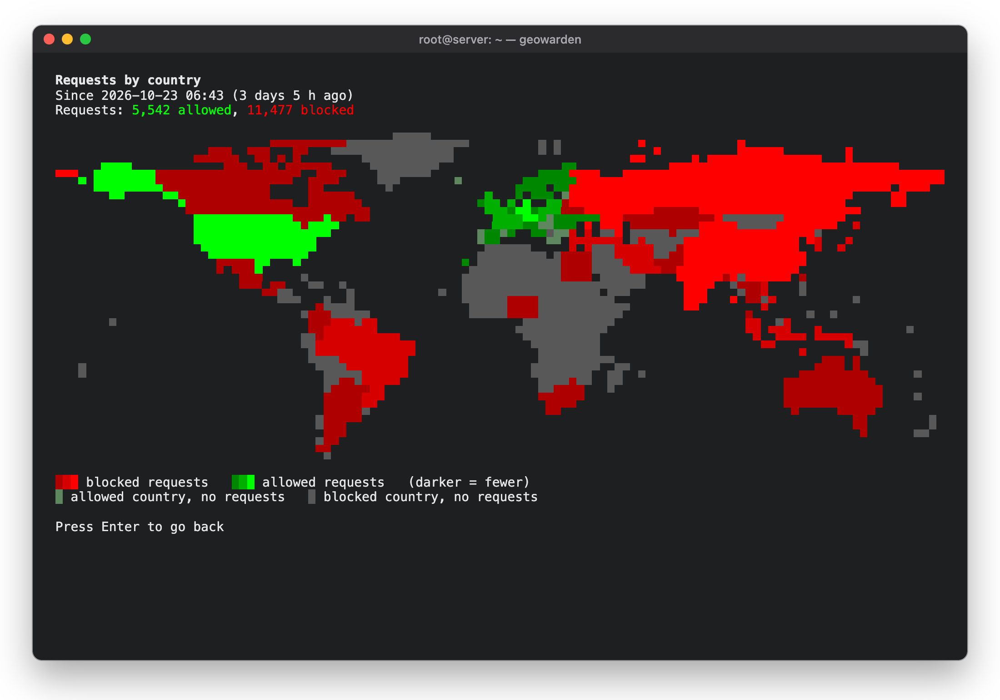
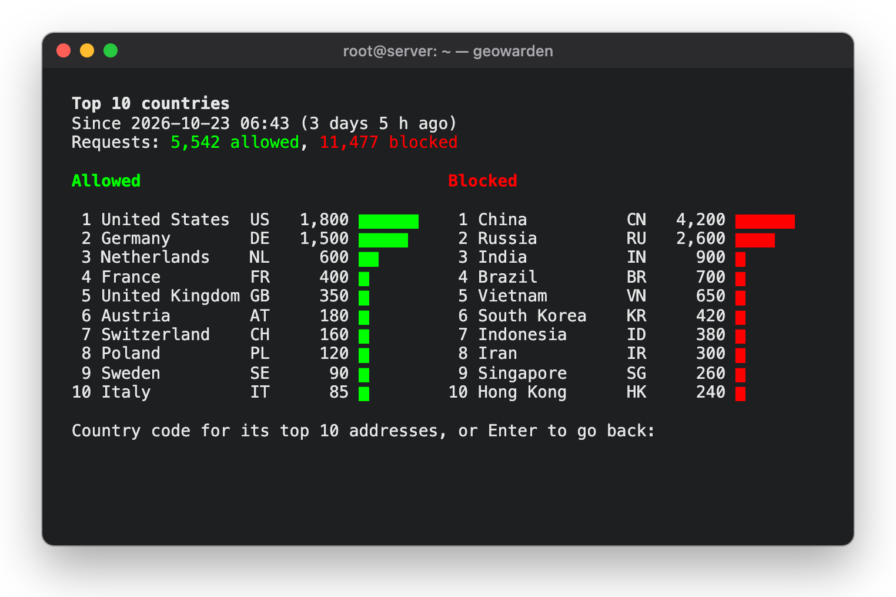
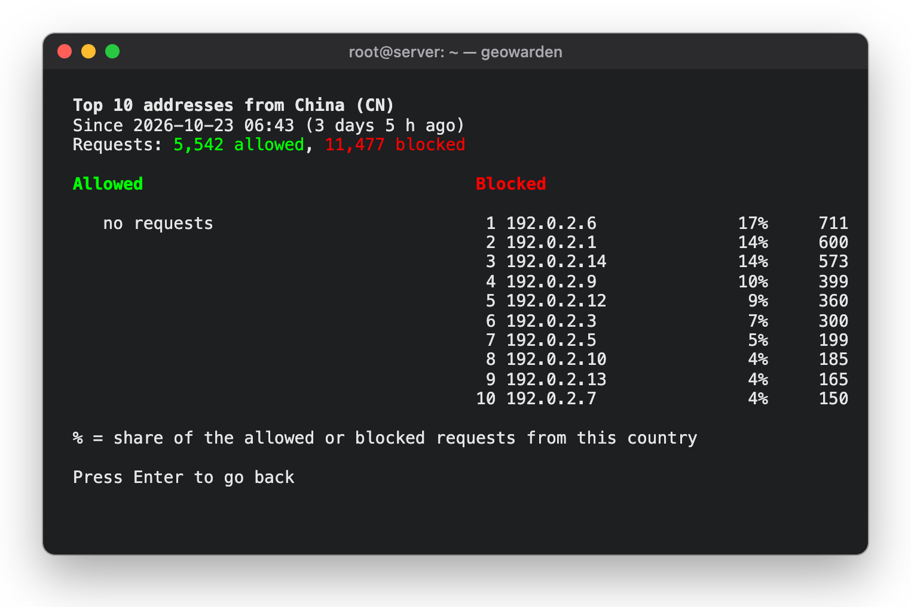
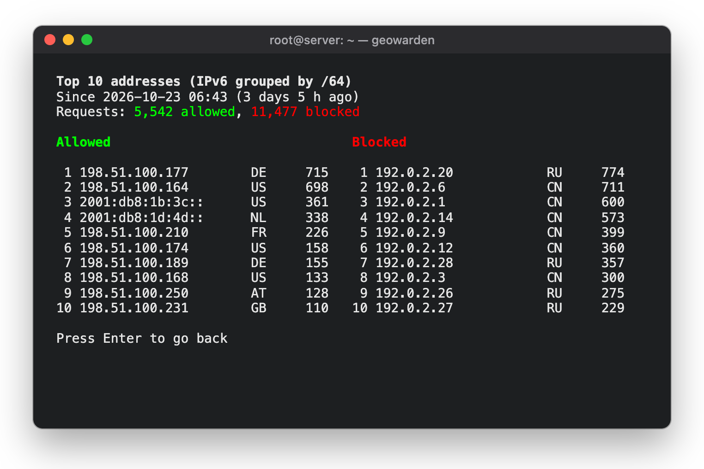
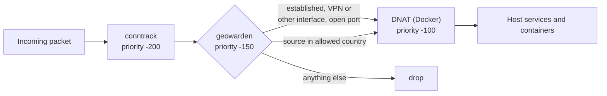

<div align="center">

# geowarden

**A country allowlist for Linux servers: built on nftables, managed through a simple terminal menu.**

New connections to your server's public interfaces are accepted only from the countries you choose.
Everything else is dropped before it reaches SSH, your web server or your Docker containers.

[](LICENSE)


</div>

## Features

- **Pick countries by continent.** Allow or block a whole continent with one choice, or tick countries one by one.
- **Daily geo data updates.** Country data comes from [DB-IP Lite](https://db-ip.com/db/lite.php). It is loaded at boot and refreshed every day by a systemd timer.
- **Hard to lock yourself out.** Blocking is off after installation. Established connections stay open. The menu warns you if your own SSH address would be blocked.
- **Plays well with VPNs and Docker.** VPN interfaces (Tailscale, WireGuard, …), Docker-internal traffic and ports you choose stay unfiltered. Filtering happens *before* Docker's DNAT, so published container ports are covered too.
- **Fails safe.** A failed download or a broken data file leaves the current rules in place. Rules are swapped in a single atomic nftables transaction.
- **Leaves other firewalls alone.** geowarden only manages its own table (`inet geowarden`). Docker, ufw, CrowdSec and others are not touched.
- **IPv4 and IPv6.** Both address families are filtered.
- **See who is knocking.** A colored world map and top 10 lists show allowed and blocked requests by country and by address. You can see when counting started and reset the statistics at any time.

## Screenshots

<p align="center">
  
  <br><sub>World map: blocked requests in red, allowed requests in green, brighter means more requests</sub>
</p>

<table>
  <tr>
    <td></td>
    <td></td>
  </tr>
  <tr>
    <td align="center"><sub>Top 10 countries for allowed and blocked requests</sub></td>
    <td align="center"><sub>Type a country code to see its top 10 addresses</sub></td>
  </tr>
  <tr>
    <td colspan="2"></td>
  </tr>
  <tr>
    <td colspan="2" align="center"><sub>Top 10 source addresses overall, with their country</sub></td>
  </tr>
</table>

<sub>The statistics screenshots show demo data with documentation addresses (RFC 5737 and RFC 3849).</sub>

<table>
  <tr>
    <td></td>
    <td></td>
  </tr>
  <tr>
    <td align="center"><sub>Status: rules loaded, blocked packets, geo data, allowed countries per continent</sub></td>
    <td align="center"><sub>Edit countries by continent</sub></td>
  </tr>
  <tr>
    <td colspan="2"></td>
  </tr>
  <tr>
    <td colspan="2" align="center"><sub>Tick individual countries with the space bar</sub></td>
  </tr>
</table>

## Requirements

- Debian 12/13 or Ubuntu 22.04/24.04 (other Debian-based systems with systemd and nftables should work too)
- Root access
- Outbound HTTPS to `download.db-ip.com` for the monthly geo data (about 5 MB)

The package pulls in its dependencies automatically: `nftables`, `curl`, `whiptail`, `python3`, `gzip`, `iproute2` and `systemd`.

## Installation

### 1. Build the package

geowarden ships as a small Debian package. Build it on the server (or any Debian/Ubuntu machine):

```bash
git clone https://github.com/tommx0/geowarden.git
cd geowarden
./build.sh
```

The package is written to `dist/geowarden_<version>_all.deb`.

### 2. Install it

```bash
sudo apt install ./dist/geowarden_*_all.deb
```

This installs the menu tool, the systemd service and the timer. The timer is enabled right away. **Blocking stays off** until you turn it on.

### 3. Turn it on

> [!IMPORTANT]
> Before you turn blocking on, make sure you reach the server from an allowed country or over an unfiltered interface such as a VPN.
> Your current SSH session stays open, but new connections from blocked countries will be rejected.

```bash
sudo geowarden
```

1. Choose **Edit countries (by continent)** and select the countries you want to allow.
   By default, Europe (without Russia and Belarus) and the United States are allowed.
2. Choose **Turn blocking on**. geowarden downloads the geo data and loads the rules.
3. Open **Show status** to check that the rules are loaded.

To check from the shell instead:

```bash
sudo nft list chain inet geowarden prerouting
```

## Usage

| Task | Command |
|---|---|
| Open the menu | `sudo geowarden` |
| Edit the configuration | `/etc/geowarden.conf` |
| Reload the rules (e.g. after a manual edit) | `sudo systemctl start geowarden.service` |
| Emergency off until the next timer run | `sudo nft delete table inet geowarden` |
| Show recent runs and errors | `journalctl -u geowarden.service` |

### Statistics and world map

Open **Statistics and world map** in the menu. The screen shows when counting started and how many requests were allowed and blocked since then. From there you can open:

| View | What it shows |
|---|---|
| **World map** | Every country colored by its requests: red for blocked, green for allowed. Brighter means more requests. Countries without requests stay muted. |
| **Top 10 countries** | The ten countries with the most allowed and the most blocked requests, side by side. Type a country code (e.g. `cn`) to see the top 10 addresses of that country and their share of its requests. |
| **Top 10 addresses** | The ten source addresses with the most allowed and the most blocked requests (IPv6 grouped by /64 network) |
| **Reset statistics** | Clears all counters. Counting starts again from that moment. |

Good to know:

- A request is the first packet of a new connection that reaches the country check. Traffic on open ports, VPN interfaces and established connections is not counted. A client that retries a blocked connection counts once per attempt.
- The statistics live in the kernel. They keep counting through the daily reload, but start over after a reboot or when you turn blocking off and on again.
- Each of the four lists (IPv4 and IPv6, allowed and blocked) keeps up to `STATS_MAX` addresses, 10,000 by default. One address needs about 160 to 280 bytes of kernel memory depending on the number of CPUs, so the default uses at most about 6 to 11 MB. If a list is full, new addresses still count in the totals, and the views tell you how many requests they cannot place. The busiest addresses are usually listed early, so the top 10 stay meaningful.
- The map needs a terminal with 256 colors and at least 44×16 characters. A wider terminal gives a more detailed map.

### Configuration

All settings live in `/etc/geowarden.conf`. The menu edits `ENABLED` and `COUNTRIES` for you. Edit the others by hand, then reload the rules.

| Variable | Meaning | Default |
|---|---|---|
| `ENABLED` | Blocking on (`yes`) or off (`no`) | `no` |
| `COUNTRIES` | Allowed countries as lower-case ISO 3166 codes, separated by spaces | Europe without RU/BY, plus US |
| `WAN_IF` | Interfaces to filter. Empty means the interfaces of the default routes | empty |
| `OPEN_TCP` | TCP ports open to the whole world | `80` (Let's Encrypt HTTP-01) |
| `OPEN_UDP` | UDP ports open to the whole world | `41641` (Tailscale) |
| `STATS_MAX` | Most addresses per statistics list. `0` turns the statistics off. A change starts the statistics over | `10000` |

Example:

```bash
ENABLED="yes"
COUNTRIES="at ch de"
WAN_IF="eth0"
OPEN_TCP="80 443"
OPEN_UDP=""
```

## How it works

`geowarden.timer` runs `geowarden-apply` one minute after boot and once a day. The script

1. uses this month's DB-IP file from `/var/cache/geowarden`, or downloads it (falling back to last month's file early in the month),
2. extracts the IP ranges of the allowed countries,
3. replaces the nftables table `inet geowarden` in one atomic transaction.

The rules hook into `prerouting` at priority −150. That is after connection tracking and before Docker's DNAT:



These are always accepted:

- packets on interfaces other than the filtered ones (VPN, Docker bridges, `lo`)
- established and related connections
- the ports in `OPEN_TCP` and `OPEN_UDP`
- DHCP replies, IPv6 link-local traffic and IPv6 neighbor discovery

Every request that reaches the country check is counted per source address in dynamic nftables sets (`stat_allow4`, `stat_block4`, `stat_allow6`, `stat_block6`). The menu looks up the country of each address in the cached DB-IP file when you open the statistics. The daily reload replaces only the rule chain and the allowlist, so the counters keep running.

## Uninstall

```bash
sudo apt remove geowarden   # removes the rules and disables the timer
sudo apt purge geowarden    # also deletes /etc/geowarden.conf and the geo data cache
```

## Good to know

- **Geolocation is never perfect.** Addresses of cloud providers, hosting companies and VPN services can be mapped to a country that differs from their real location.
- **Let's Encrypt** validates HTTP-01 challenges from servers worldwide. Keep port 80 in `OPEN_TCP` if you use it, or switch to DNS-01.
- **EU geo-blocking rules.** If you sell goods or services in the EU, note Regulation (EU) 2018/302: customers from other EU countries must not be blocked without an objective reason.

## Disclaimer

geowarden is provided **as is, without any warranty**. Use it at your own risk.
It changes your server's firewall: a wrong setting can lock you out or let unwanted traffic in.
Geolocation data can be wrong or out of date. The author accepts no liability for damage,
data loss, downtime or any other consequences of using this software.

## License

geowarden is released under the [MIT License](LICENSE), which includes the same disclaimer of warranty and liability.

The geo data is downloaded at runtime and is not part of this project:
[IP Geolocation by DB-IP](https://db-ip.com), licensed under [CC BY 4.0](https://creativecommons.org/licenses/by/4.0/).

The world map ([src/worldmap.txt](src/worldmap.txt)) is generated with [tools/make-worldmap.py](tools/make-worldmap.py) from
[Natural Earth](https://www.naturalearthdata.com/) 1:50m country borders, which are in the public domain.
