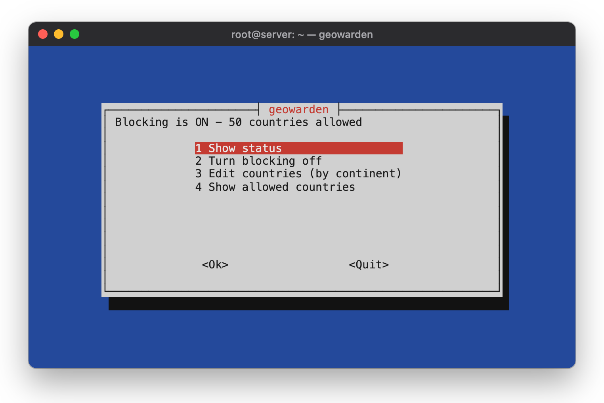
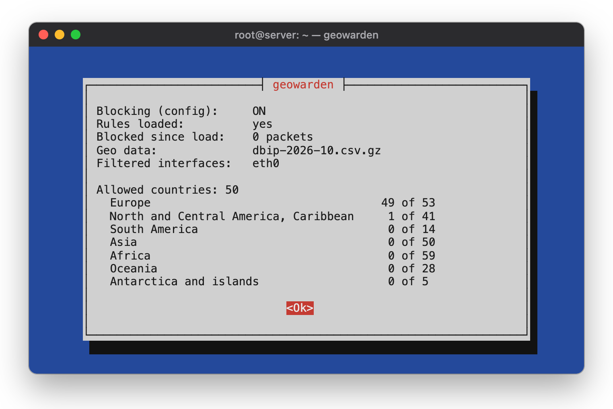
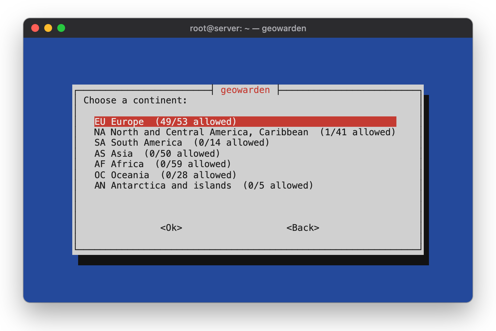
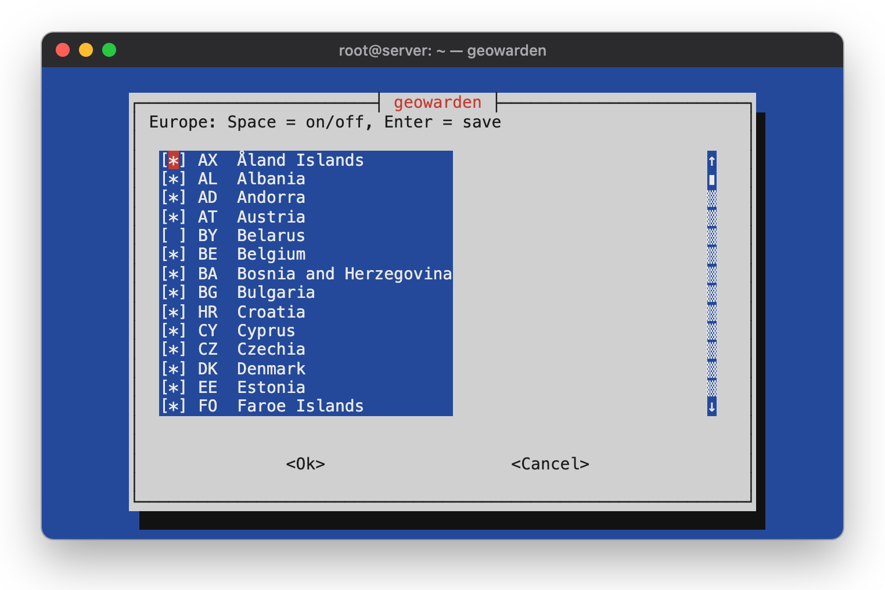
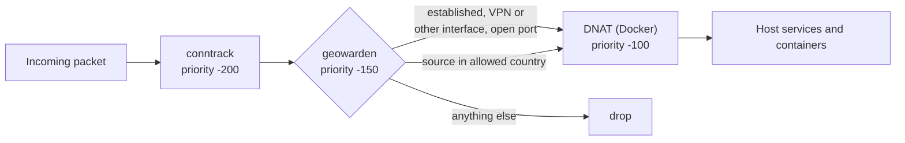

<div align="center">

# geowarden

**A country allowlist for Linux servers: built on nftables, managed through a simple terminal menu.**

New connections to your server's public interfaces are accepted only from the countries you choose.
Everything else is dropped before it reaches SSH, your web server or your Docker containers.

[](LICENSE)




</div>

## Features

- **Pick countries by continent.** Allow or block a whole continent with one choice, or tick countries one by one.
- **Daily geo data updates.** Country data comes from [DB-IP Lite](https://db-ip.com/db/lite.php). It is loaded at boot and refreshed every day by a systemd timer.
- **Hard to lock yourself out.** Blocking is off after installation. Established connections stay open. The menu warns you if your own SSH address would be blocked.
- **Plays well with VPNs and Docker.** VPN interfaces (Tailscale, WireGuard, …), Docker-internal traffic and ports you choose stay unfiltered. Filtering happens *before* Docker's DNAT, so published container ports are covered too.
- **Fails safe.** A failed download or a broken data file leaves the current rules in place. Rules are swapped in a single atomic nftables transaction.
- **Leaves other firewalls alone.** geowarden only manages its own table (`inet geowarden`). Docker, ufw, CrowdSec and others are not touched.
- **IPv4 and IPv6.** Both address families are filtered.

## Screenshots

<table>
  <tr>
    <td></td>
    <td></td>
  </tr>
  <tr>
    <td align="center"><sub>Status: rules loaded, blocked packets, geo data, allowed countries per continent</sub></td>
    <td align="center"><sub>Edit countries by continent</sub></td>
  </tr>
  <tr>
    <td colspan="2"></td>
  </tr>
  <tr>
    <td colspan="2" align="center"><sub>Tick individual countries with the space bar</sub></td>
  </tr>
</table>

## Requirements

- Debian 12/13 or Ubuntu 22.04/24.04 (other Debian-based systems with systemd and nftables should work too)
- Root access
- Outbound HTTPS to `download.db-ip.com` for the monthly geo data (about 5 MB)

The package pulls in its dependencies automatically: `nftables`, `curl`, `whiptail`, `python3`, `gzip`, `iproute2` and `systemd`.

## Installation

### 1. Build the package

geowarden ships as a small Debian package. Build it on the server (or any Debian/Ubuntu machine):

```bash
git clone https://github.com/tommx0/geowarden.git
cd geowarden
./build.sh
```

The package is written to `dist/geowarden_<version>_all.deb`.

### 2. Install it

```bash
sudo apt install ./dist/geowarden_*_all.deb
```

This installs the menu tool, the systemd service and the timer. The timer is enabled right away. **Blocking stays off** until you turn it on.

### 3. Turn it on

> [!IMPORTANT]
> Before you turn blocking on, make sure you reach the server from an allowed country or over an unfiltered interface such as a VPN.
> Your current SSH session stays open, but new connections from blocked countries will be rejected.

```bash
sudo geowarden
```

1. Choose **Edit countries (by continent)** and select the countries you want to allow.
   By default, Europe (without Russia and Belarus) and the United States are allowed.
2. Choose **Turn blocking on**. geowarden downloads the geo data and loads the rules.
3. Open **Show status** to check that the rules are loaded.

To check from the shell instead:

```bash
sudo nft list chain inet geowarden prerouting
```

## Usage

| Task | Command |
|---|---|
| Open the menu | `sudo geowarden` |
| Edit the configuration | `/etc/geowarden.conf` |
| Reload the rules (e.g. after a manual edit) | `sudo systemctl start geowarden.service` |
| Emergency off until the next timer run | `sudo nft delete table inet geowarden` |
| Show recent runs and errors | `journalctl -u geowarden.service` |

### Configuration

All settings live in `/etc/geowarden.conf`. The menu edits `ENABLED` and `COUNTRIES` for you. Edit the others by hand, then reload the rules.

| Variable | Meaning | Default |
|---|---|---|
| `ENABLED` | Blocking on (`yes`) or off (`no`) | `no` |
| `COUNTRIES` | Allowed countries as lower-case ISO 3166 codes, separated by spaces | Europe without RU/BY, plus US |
| `WAN_IF` | Interfaces to filter. Empty means the interfaces of the default routes | empty |
| `OPEN_TCP` | TCP ports open to the whole world | `80` (Let's Encrypt HTTP-01) |
| `OPEN_UDP` | UDP ports open to the whole world | `41641` (Tailscale) |

Example:

```bash
ENABLED="yes"
COUNTRIES="at ch de"
WAN_IF="eth0"
OPEN_TCP="80 443"
OPEN_UDP=""
```

## How it works

`geowarden.timer` runs `geowarden-apply` one minute after boot and once a day. The script

1. uses this month's DB-IP file from `/var/cache/geowarden`, or downloads it (falling back to last month's file early in the month),
2. extracts the IP ranges of the allowed countries,
3. replaces the nftables table `inet geowarden` in one atomic transaction.

The rules hook into `prerouting` at priority −150. That is after connection tracking and before Docker's DNAT:



These are always accepted:

- packets on interfaces other than the filtered ones (VPN, Docker bridges, `lo`)
- established and related connections
- the ports in `OPEN_TCP` and `OPEN_UDP`
- DHCP replies, IPv6 link-local traffic and IPv6 neighbor discovery

## Uninstall

```bash
sudo apt remove geowarden   # removes the rules and disables the timer
sudo apt purge geowarden    # also deletes /etc/geowarden.conf and the geo data cache
```

## Good to know

- **Geolocation is never perfect.** Addresses of cloud providers, hosting companies and VPN services can be mapped to a country that differs from their real location.
- **Let's Encrypt** validates HTTP-01 challenges from servers worldwide. Keep port 80 in `OPEN_TCP` if you use it, or switch to DNS-01.
- **EU geo-blocking rules.** If you sell goods or services in the EU, note Regulation (EU) 2018/302: customers from other EU countries must not be blocked without an objective reason.

## License

geowarden is released under the [MIT License](LICENSE).

The geo data is downloaded at runtime and is not part of this project:
[IP Geolocation by DB-IP](https://db-ip.com), licensed under [CC BY 4.0](https://creativecommons.org/licenses/by/4.0/).
